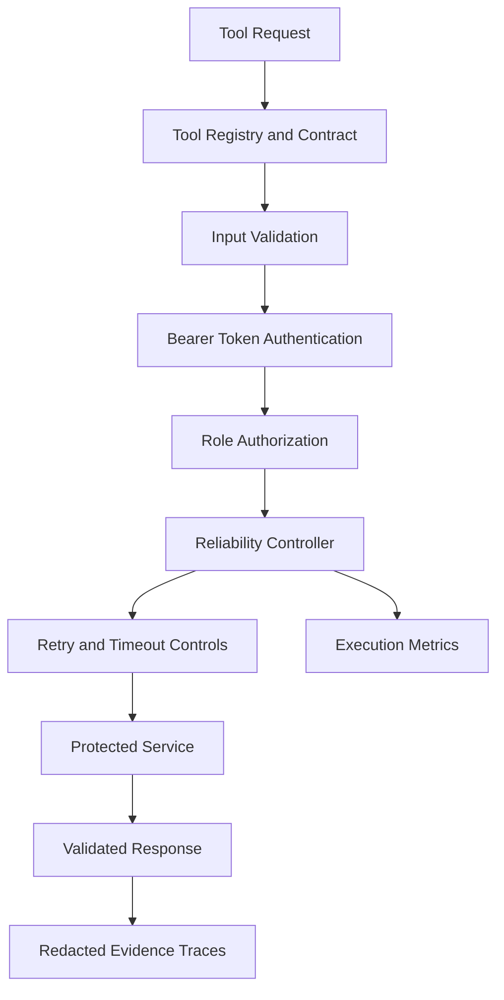

# Authentication Assessment — Operator Report

## 1. Executive Summary

The Authentication Assessment implements a protected service-to-service tool call with bearer-token authentication, role-based authorization, request validation, retry controls, timeout handling, caching, and structured evidence traces.

The evidence generator completed three scenarios with the expected classifications: successful request, denied access, and protected-service failure. The complete automated test suite passed **40 tests**.

## 2. Assessment Objectives

- Define a validated tool contract and registry.
- Issue and validate short-lived authentication tokens.
- Authenticate service-to-service requests and enforce role authorization.
- Validate requests and handle service failures safely.
- Apply reliability controls, including retry limits, timeouts, rate limits, and caching.
- Generate redacted evidence and operational metrics.

## 3. Architecture



The dispatcher coordinates validation, authentication, authorization, and execution. The token provider validates token records without storing raw tokens as lookup keys. The reliability controller applies execution controls and records metrics.

## 4. Security Controls

- Short-lived bearer tokens issued by a fake credential provider for assessment purposes.
- SHA-256 token digests used for token-record lookup.
- Role-based authorization before protected-service execution.
- Strict input models that reject unexpected fields.
- Sanitized error responses.
- Redaction of credentials and resource identifiers in generated evidence.
- No protected-service call for the tested unauthorized-role scenario.

**Scope limitation:** The fake token provider is a demonstration component, not a production identity provider. A production implementation would require an appropriately secured identity system, secret management, transport security, and operational key-rotation procedures.

## 5. Evidence Results

| Scenario | Observed result | Supporting evidence |
|---|---|---|
| Successful request | Success | `traces/success.json` |
| Unauthorized role | Denied | `traces/access_denied.json` |
| Protected-service failure | Failure | `traces/provider_failure.json` |

The evidence summary is stored at `outputs/evidence_summary.json`.

### Observed metrics

| Metric | Successful request | Access denied | Provider failure |
|---|---:|---:|---:|
| Protected-service calls | 1 | 0 | 1 |
| Attempts recorded | 1 | Not applicable | 1 |
| Success counter | 1 | Not recorded | 0 |
| Failure counter | 0 | Not recorded | 1 |
| Retries | 0 | Not recorded | 0 |
| Timeout counter | 0 | Not recorded | 0 |

The access-denied path returns before protected-service execution, so its trace does not contain the execution metrics object. These missing values are **not equivalent to measured zeros**.

## 6. Reliability and Observability

The implementation includes bounded retry behavior, execution timeouts, rate limiting, concurrency control, successful-result caching, and execution metrics. Retry attempts and failure types can be inspected in the trace output.

The evidence run demonstrated one successful protected-service call and one simulated provider failure. The unauthorized request was rejected before the service was called.

These three scenarios are representative checks, not proof of production-scale capacity or comprehensive security assurance.

## 7. Verification

Automated verification command:

```cmd
python -m pytest -q
```

Latest recorded result:

```text
40 passed in 0.26s
```

Evidence-generation command:

```cmd
python outputs\generate_evidence.py
```

## 8. Reflection and Lessons Learned

This assessment demonstrates why authentication, authorization, and execution reliability must be treated as separate responsibilities. A valid token alone should not grant access to every tool; the caller's role must also satisfy the tool's access policy. Strict input validation and sanitized errors help prevent malformed requests and internal details from leaking through the interface.

The evidence-generation process also highlighted the importance of verifying the actual response contract. Initially, the generator classified all scenarios as denied because it read a field that was not present at the expected location. Inspecting the traces and correcting the classification logic produced the expected outcomes without changing the dispatcher. The full suite then remained green.

The next improvement would be to add more evidence for expired tokens, malformed authorization headers, timeout recovery, rate-limit enforcement, and successful retry after a transient failure. Production deployment would also require a real identity provider, secure transport, centralized secret management, and monitored audit retention.
